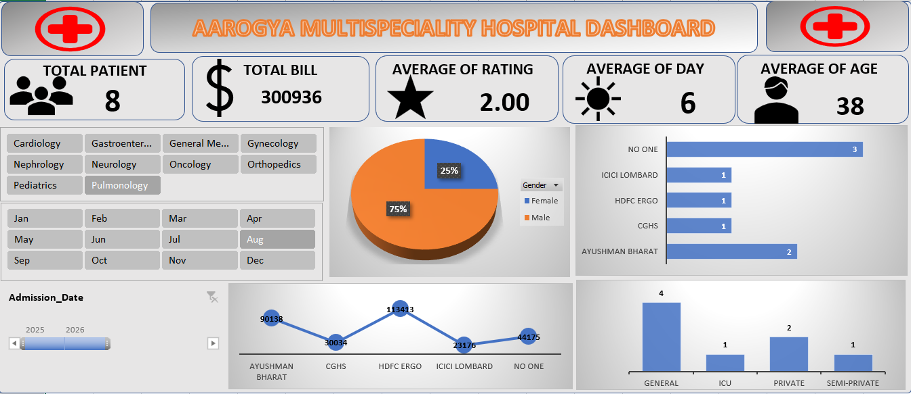

# hospital_dashboard
 Excel Data Analysis Project

## 📌 Project Overview
This project is an interactive Hospital Dashboard developed using Microsoft Excel. The main objective of this project is to perform complete hospital data analysis and transform raw hospital data into meaningful insights.

This project was created as part of my Data Analyst learning journey to practice Excel data analysis, visualization, and dashboard development.

## 🎯 Project Objectives
- Analyze hospital and patient-related data.
- Understand department-wise patient distribution.
- Analyze hospital billing and ratings.
- Explore average patient age and length of stay.
- Present meaningful insights through an interactive dashboard.

## 📊 Key Performance Indicators (KPIs)

The dashboard includes five KPIs:

1. **Total Patients** – Displays the total number of patients.
2. **Total Bill** – Shows the total hospital billing amount.
3. **Average Rating** – Displays the average patient rating.
4. **Average Stay (Days)** – Shows the average number of days patients stay in the hospital.
5. **Average Age** – Displays the average age of patients.

## 📈 Charts & Visualizations

The dashboard uses the following charts:

- Pie Chart
- Bar Chart
- Line Chart
- Column Chart

These visualizations help present hospital data in an easy-to-understand format.

## 🎛️ Interactive Dashboard Features

The dashboard contains three interactive slicers:

- **Department Slicer:** Filters hospital data by department.
- **Month Slicer:** Filters data based on different months.
- **Year Slicer:** Filters data based on different years.

All three slicers are connected to the dashboard KPIs and charts, allowing users to dynamically explore the data.

## 🔍 Key Insights

1. **Patient Analysis:** Patient count and hospital billing change dynamically based on selected departments, months, and admission dates.

2. **Gender Distribution:** The dashboard highlights the distribution of male and female patients, helping identify gender-wise admission patterns.

3. **Insurance Analysis:** The dashboard compares different insurance providers, including Ayushman Bharat, CGHS, HDFC Ergo, and ICICI Lombard, along with patients without insurance.

4. **Hospital Billing:** Total billing varies across different filter selections, allowing a comparison of billing performance across departments and time periods.

5. **Patient Stay & Age:** Average length of stay and average patient age provide insights into patient demographics and hospital utilization.

6. **Ward Utilization:** General, ICU, Private, and Semi-Private ward distributions help understand patient allocation across different wards.

7. **Interactive Analysis:** Department slicers, month filters, and admission date timelines allow users to explore hospital data from multiple perspectives.

## 🛠️ Tools & Technologies Used

- Microsoft Excel
- Pivot Tables
- Pivot Charts
- Excel Slicers
- Excel Formulas
- Conditional Formatting
- Data Cleaning
- Power Query
- VBA (Visual Basic for Applications)

## ⚙️ Data Preparation & Automation

- Used Power Query for data preparation and transformation.
- Used VBA code for data cleaning.
- Used VBA to change and correct date formats.
- Used Pivot Tables and Pivot Charts for data analysis and visualization.

## 🖼️ Dashboard Preview

The final dashboard preview is shown below.

## 👨‍💻 About the Author

This project is part of my journey toward becoming a Data Analyst. Through this project, I practiced Excel data analysis, dashboard creation, data cleaning, and visualization.
